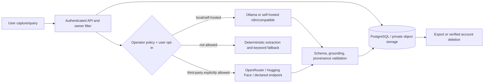

# AI Data Governance and Provider Register

Last reviewed: 2026-09-12. Owner: Memoryhive security and operations.

## Policy

External AI processing requires both operator authorization and the user's
explicit opt-in. New users default to external processing disabled. Local-only
users retain capture, deterministic extraction, keyword search, and all
provider-free library behavior. Provider keys belong only in environment/secret
managers; APIs, exports, logs, Temporal payloads, and repository files must never
contain credentials.

Only the minimum bounded text/image needed for the selected task is transferred.
Account email, name, tags unrelated to the task, object-storage credentials,
internal URLs, and full account history are excluded. Query embeddings and recall
questions are not persisted. Model diagnostics retain hashes, opaque IDs, task,
provider/model aliases, token/cost/latency, status, and bounded error codes; raw
content is excluded unless an operator separately enables encrypted debugging.

## Provider register

| Provider | Classification | Transfer and purpose | Endpoint/retention/residency owner |
|---|---|---|---|
| Ollama | Local by default; configurable self-hosted/third-party | Bounded content for enrichment, embeddings, reranking, vision | Operator; local endpoint and storage policy |
| n8n | Self-hosted by default; configurable third-party | Versioned signed analysis payload | Operator; configured webhook and workflow retention |
| OpenRouter | Third-party | Bounded prompts/embeddings for explicitly routed tasks | OpenRouter account owner; verify vendor retention/residency before enablement |
| Hugging Face Inference Providers | Third-party | Bounded prompts/images/embeddings through allowlisted models/providers | Hugging Face account owner; verify selected inference provider policy |
| OpenAI-compatible | Local, self-hosted, or third-party as explicitly declared | Bounded prompts/embeddings to an allowlisted host | Operator and named endpoint vendor; generic URLs receive no implicit trust |

Operators must record the concrete vendor, region, retention setting, DPA/legal
basis, subprocessors, model allowlist, and deletion contact in the production
secret/configuration inventory before enabling a third-party route. The mobile
`STORE_EXTERNAL_AI_PROCESSING` declaration must match the deployed classification;
automated store-readiness tests reject enabled OpenRouter, Hugging Face, generic
compatible, or remote automation endpoints paired with `none`.

## Data flow

## Retention and deletion

- Source items and derived AI records follow the account's retention policy.
- Provider-side retention must be disabled where supported and documented above;
  vendor retention never replaces Memoryhive deletion duties.
- Account deletion explicitly removes embeddings, chunks, suggestions,
  preferences, interaction/feedback events, enrichment history, AI usage, run
  audit/provenance, source rows, and private objects. Content-free lifecycle audit
  records may remain only to prove deletion completion.
- Backups follow the documented backup retention window and deletion schedule.
- Diagnostic logs use opaque correlation/workflow/item references and normalized
  error codes. Never log prompt, response, authorization header, token, or key.

## Threat model and controls

| Threat | Required control |
|---|---|
| Cross-tenant retrieval or generation | Owner predicate before candidate retrieval; citations reference only accessible items; negative tests |
| SSRF/DNS rebinding/redirect to private services | HTTPS and exact host allowlist; literal and resolved-IP checks; private-network double opt-in; redirects disabled |
| Header/credential injection | Block authorization, cookie, host, proxy, transfer, and API-key extension headers; secret response redaction |
| Prompt injection from saved content | Treat content as untrusted data; strict schema; server grounding/citation validation |
| Oversized or costly payload | Gateway byte limits, bounded passages/chunks, timeouts, concurrency, per-user/system budgets |
| Provider outage or compromise | Circuit breaker, immediate provider-disable flag, local/deterministic fallback, content-safe telemetry |
| Residual derived data after deletion | Explicit table deletion plus object deletion jobs and lifecycle audit verification |

Security review must rerun SSRF, redirect, header injection, secret redaction,
oversized-input, cross-user, local-only routing, export, and deletion tests before
enabling a new provider or endpoint.
